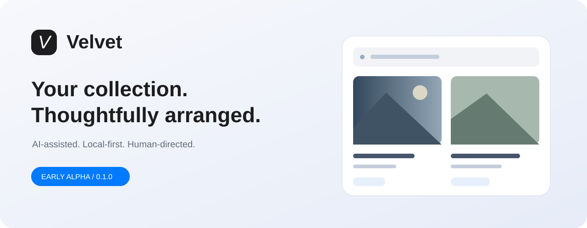
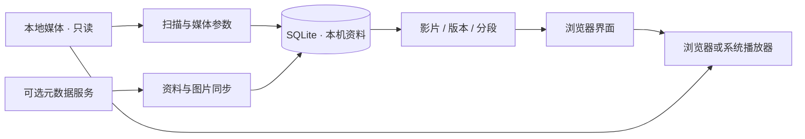

<div align="center">



<sub>界面概念示意 · 不含真实媒体</sub>

**让本地收藏更好找、更好选、更好看。**

AI 辅助开发 · 本地优先 · 元数据自动整理 · 影片 / 版本 / 分段


[快速开始](#快速开始) · [完整功能](docs/FEATURES.md) · [需求与路线图](docs/REQUIREMENTS.md) · [架构](docs/ARCHITECTURE.md) · [参与开发](CONTRIBUTING.md)

</div>

## 为什么做 Velvet

硬盘里有文件，不等于拥有好用的资料库。相同影片的不同画质、散落的分段、反复修改的标签、难以回到原位的筛选，都会让挑选变得费力。

Velvet 想把这段体验整理好：**以影片为浏览入口，以版本为播放选择，以文件为实际载体**。先用封面、截图和清晰的属性挑选，再播放合适的那一份。原视频保留原位，整理的是关系和资料。

这是一个由 AI 辅助开发、由真实使用需求驱动的早期实验项目。目前发布的是 **`0.1.0-alpha.4` 公开测试版**，不是成熟媒体服务器，也不应仅凭功能入口或测试通过就推断全部场景已经完善。

## 有什么特色

### 内容优先的界面

中性配色、简洁侧栏、浅色 / 深色外观与渐进展开的筛选。详情标题、关闭键与主操作分区固定，减少滚动寻找；视频卡片保留封面、分辨率和分段等关键信息。

### 一部影片，多种选择

支持建立影片、版本和分段关系，手动修正与撤销。默认版本与“优先保留”关联；分段在同一个入口中选择，避免把两段正片误当成两份副本。

### 自动整理，可解释、可修正

从文件、媒体参数、NFO 与可选元数据服务获取资料。规则标签和来源标签帮助筛选；手改字段可独立保护，来源差异可查看。自动匹配有局限，未知信息和失败任务会保留状态，用户能够纠正。

### AI-assisted，human-directed

AI 参与需求讨论、实现、文档与测试编写；产品规则仍由用户决定。我们希望持续探索 AI 如何让媒体整理更自然，同时明确能力边界：

|现在|未来探索，尚未实现|
|---|---|
|AI 辅助开发与迭代；规则和元数据驱动的分类|自然语言检索与片单生成|
|自动任务、字段来源对比、人工纠正|可选择模型的语义标签建议|
|媒体、截图和资料保存在本机|用户选择开启的视觉语义检索|

**当前没有内置 LLM、视觉理解或向量检索，不会因为“AI”这个名称而自动上传视频。** 配置联网元数据服务后，会向该服务提交识别出的影片编号；图片和资料的联网访问受该服务配置控制。

## 当前能做什么

|功能|本版状态与限制|
|---|---|
|媒体库|目录选择/浏览、单库扫描、自动化策略、排除及离线保护；批量导入和异常恢复待完善|
|刮削|10 个独立内置适配器、自动持久队列、来源/字段择优、站点凭据、七天来源缓存；另可接 Amane|
|来源诊断|24 项来源目录（不等于 24 项原生实现）、网络检测和失败原因；可用性依赖网络与账号|
|浏览筛选|搜索、组合标签、演员/厂商、媒体属性和资料状态；分类页及分类收藏；动态片单待做|
|图片详情|六帧截图、封面/海报、持久剧照队列、单项重试和放大画廊；可关闭的延迟悬停截图预览|
|演员|精确头像匹配/缓存、资料、评分收藏、参演影片；人工别名治理待做|
|影片结构|影片/版本/分段、默认版本、手动关系修正和撤销；命名推断需人工核对|
|播放|Range 直放、续播、分段接续、系统播放器入口；无转码及字幕/音轨选择|
|重复对比|完整 SHA-256、同片版本候选和保留偏好；不自动删文件，无感知指纹|
|文件质量|只读探测/抽样/全解码、人工水印/损坏标记、个人画质目标、待更新清单；无自动水印识别|
|管理与保护|三管理入口、地址/历史恢复、字段锁、备份校验和恢复；完整恢复演练待补|
|部署|Windows 为主要验证环境，附跨平台 Python/Docker 配置；NAS 和其它平台实机待验收|

完整入口与边界见 [功能清单](docs/FEATURES.md)；未完成需求与验收缺口见 **[需求审计表](docs/REQUIREMENTS.md)**。

## 快速开始

需要 **Python 3.10+**。基础运行与外部元数据服务模式使用 Python 标准库；启用内置刮削需要先安装 `requirements.txt`。

```bash
git clone https://github.com/elk-alter/velvet.git
cd velvet
python app.py
```

Windows 也可以双击 `启动.bat`。macOS/Linux 使用 `python3 app.py` 或 `sh start.sh`；非 Windows 目录选择器还依赖系统可用的 Tk。

浏览器打开 **http://127.0.0.1:8765**，选择媒体目录。只运行服务、不自动打开浏览器：

```bash
python app.py --no-browser
```

### 启用截图和媒体信息

安装 FFmpeg，确保 `ffmpeg` 和 `ffprobe` 位于 PATH；也可将它们放进项目的 `tools/` 目录。首次处理可能较慢，先用少量文件验证。具体安装请参考 [FFmpeg 官方下载说明](https://ffmpeg.org/download.html)。

### 连接元数据服务

在“刮削中心 → 执行与网络”可连接独立运行的 **[Amane](https://github.com/sqzw-x/amane)**。默认本机地址为 `http://127.0.0.1:18000`；Windows 下可读取其默认 Token 文件，也支持显式填写连接信息。

项目提供 10 个移植自 Amane 的内置采集适配器，安装 `python -m pip install -r requirements.txt` 后，在“刮削中心 → 执行与网络”选择“Velvet 内置”；原有外部模式继续可用。内置引擎的范围、代理、测试与限制见 [内置刮削](docs/BUILTIN-SCRAPING.md)。

外部模式下，Amane 不是本项目打包的依赖。Velvet 通过公共 API 读取资料和缓存图片，不调用原视频整理；自动任务仍受来源可访问性、编号识别和网络情况影响。详见 [使用与配置](docs/USAGE.md)。网络检测、来源开关、字段择优和媒体库配置见 [管理功能说明](docs/NETWORK-AND-LIBRARIES.md)。新增独立管理页面及完整来源目录，执行方式和依赖见 [来源与界面](docs/SOURCES-AND-UI.md)。单一刮削入口、演员头像、分类与海报浏览见 [浏览更新](docs/BROWSING-UPDATE.md)。站点配置、独立剧照队列与详情画廊见 [独立刮削与剧照](docs/INDEPENDENT-SCRAPING.md)。

### 数据在哪里

默认 `data/` 保存数据库、配置、图片与备份。可使用 `VELVET_DATA` 指向独立目录。**不要把自己的 `data/`、`.env`、Token、视频或私人截图提交到 Git。** 项目已提供忽略规则。

Docker/NAS 为实验部署方式，见 [部署说明](docs/DEPLOYMENT.md)。默认本地模式仅监听回环地址。

## 技术结构



Python HTTP 服务与 SQLite 提供本机后端，原生 HTML/CSS/JavaScript 提供界面，FFmpeg 提供媒体信息和截图。目前仍是原型结构：服务端分页、模块拆分、任务持久化一致性与更完整的异常处理都需要继续推进。

## 测试与版本定位

```bash
python -m unittest discover -s . -p "test_*.py"
```

现有测试覆盖部分模型、关系撤销、偏好、备份恢复、队列与 HTTP 流程。浏览器交互也做过演示数据和本机服务检查；**这些不是全编码、全平台、长时间运行或大规模片库的完整验收**。仓库提供 [跨平台 CI 配置示例](docs/ci.example.yml)，计划在 Windows、macOS、Linux 上运行后端测试；当前尚未启用自动工作流，测试结果也不等于这些平台已实机可用。

当前版本为 `0.1.0-alpha.4`，从 `0.1.0-alpha.1` 建立公开预发布基线。下一轮优先刮削恢复、待匹配工作台与数据一致性，再推进标签治理、大库和部署。参见 [CHANGELOG](CHANGELOG.md) 和 [路线图](docs/ROADMAP.md)。

## 反馈与贡献

欢迎提交可复现问题、小范围修复和需求讨论。请使用虚构文件名与脱敏日志，避免在 Issue 中附带私人媒体、演员偏好或连接凭证。贡献流程见 [CONTRIBUTING](CONTRIBUTING.md)，安全反馈见 [SECURITY](SECURITY.md)。

公开可见不意味着所有能力已生产可用。项目以 [GPL-3.0](LICENSE) 发布；移植组件与修改说明见 [NOTICE](NOTICE)。

## 文档导航

- [文件质量与待处理](docs/FILE-QUALITY.md)
- [完整功能清单](docs/FEATURES.md) · [需求与验收](docs/REQUIREMENTS.md) · [迭代路线图](docs/ROADMAP.md)
- [使用与配置](docs/USAGE.md) · [管理区导航](docs/MANAGEMENT-NAVIGATION.md) · [部署与升级](docs/DEPLOYMENT.md)
- [架构](docs/ARCHITECTURE.md) · [发布流程](docs/RELEASING.md) · [本版说明](docs/RELEASE-0.1.0-alpha.4.md)

最新结构审计与改进清单见 [体验审计](docs/UX-AUDIT.md)，自动识别说明见 [自动标记](docs/AUTOMATIC-MARKS.md)。

开发流程、模块边界、测试与迁移控制见 [开发文档入口](docs/development/README.md)。
