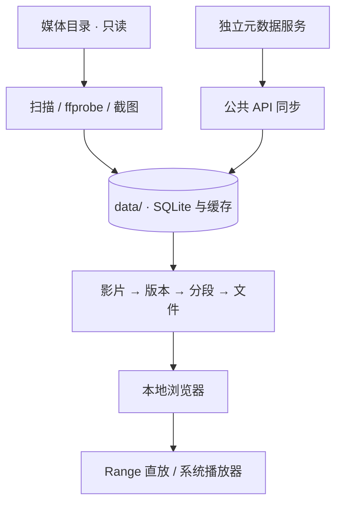

# Architecture

## 当前实现

- `app.py`：HTTP 接口、SQLite 初始化、扫描、元数据同步、图片缓存、任务与本机播放器。
- `library_core.py`：影片/版本/分段关系、偏好、关系撤销和备份归档。
- `index.html`：原生浏览器 UI、筛选、详情、人物页和播放交互。
- `test_*.py`：临时资料与模拟服务上的回归测试。

这是实验结构，不是最终架构。部分共享状态仍在内存中，视图层包含较多逻辑，部分 API 全量返回资料。

## 数据边界

默认不写源目录；元数据服务与运行时凭证不随源码分发。远程元数据请求可能离开本机，具体由用户配置和服务实现决定。

## 优先重构方向

1. 拆出 HTTP、任务执行器、元数据提供方、仓储与配置模块。
2. 使用明确的版本化 API 契约和一致的请求校验。
3. 把任务状态和恢复策略持久化，避免依赖进程内标志。
4. 将查询、筛选、聚合与分页逐步移至服务端。
5. 给自动识别、关系变更、播放进度和恢复流程建立合成媒体测试集。
6. 统一应用版本、数据库迁移版本和备份兼容策略。

产品内 AI 尚未实现；未来模型接入应作为可选提供方，不把核心浏览与播放依赖于模型在线。
