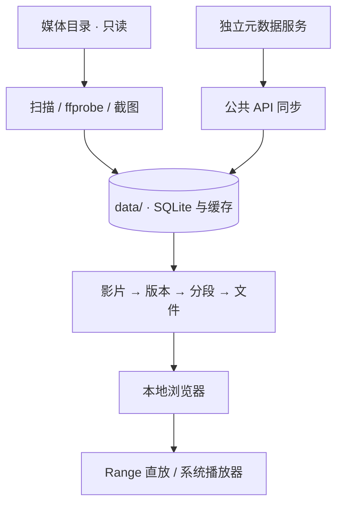

# Architecture

版本基线：0.1.0-alpha.3。功能范围见 [功能清单](FEATURES.md)。

## 当前实现

- `app.py`：HTTP 接口、SQLite 初始化、扫描、元数据同步、图片缓存、任务与本机播放器。
- `library_core.py`：影片/版本/分段关系、偏好、关系撤销和备份归档。
- `index.html`：页面骨架、基础样式、主片库筛选/播放/关系交互，仍含需要逐步拆分的内联逻辑。
- `management.js`：管理页面业务渲染；`manager_routes.js`：路由、历史/返回、请求取消、轮询与未保存提示；`management.css`：管理样式。
- `film_detail.js`：资料优先详情、图片分组/放大及播放/编辑展开。
- `source_catalog.py` / `sources.json`：脱敏来源清单与原生/外部能力区分。
- `artwork_store.py`：主片库内的持久剧照队列、下载、重试和图片清单。
- `scripts/release.py`：不导入运行服务的公开源码校验与 Git 归档。
- `test_*.py`：临时资料与模拟服务上的回归测试。
- `builtin_scraper.py`、`scrapers/`：持久队列及第一批移植采集器；网络与拦截判定由刮削和检测共享。
- `network_checks.py`：有界并发的来源诊断，不改变元数据。
- `media_libraries.py`：库配置、路径归属、过滤和统计；`management.js` 提供管理界面。
- `people_catalog.py`：人物资料/头像缓存与分类聚合；`browse.js`、`browse.css` 提供演员、分类和影片卡片。

这是实验结构，不是最终架构。部分共享状态仍在内存中，视图层包含较多逻辑，部分 API 全量返回资料。

- `file_review.py/js`：只读文件检查队列、文件标记/目标、工作台及悬停截图偏好。

## 数据边界

默认不写源目录；元数据服务与运行时凭证不随源码分发。远程元数据请求可能离开本机，具体由用户配置和服务实现决定。

## 状态与资源边界

|对象|存储/生命周期|剩余工作|
|---|---|---|
|影片、关系、偏好、人物、剧照任务|主片库 SQLite|恢复一致性、迁移及大库索引|
|内置文字队列、来源快照|独立 builtin-scraper.db|与主片库的统一任务对账和完整备份|
|扫描、同步编排、网络诊断|部分进程内状态|持久化摘要、重启恢复和统一生命周期|
|封面、截图、剧照、头像|数据目录文件缓存|候选选择、重采样、清理策略|
|浏览/管理位置|URL、浏览器存储和历史|多标签页、滚动、焦点完整回归|
|静态页面资源|app.py 中 UI_ASSETS 白名单|HTTP 测试及发布脚本共同检查，禁止任意路径映射|

主片库备份不包含图片和独立来源缓存库；完整迁移需停止应用后保存整个数据目录。版本从 VERSION 读取，不维护多个应用版本常量。

## 优先重构方向

1. 拆出 HTTP、任务执行器、元数据提供方、仓储与配置模块。
2. 使用明确的版本化 API 契约和一致的请求校验。
3. 把任务状态和恢复策略持久化，避免依赖进程内标志。
4. 将查询、筛选、聚合与分页逐步移至服务端。
5. 给自动识别、关系变更、播放进度和恢复流程建立合成媒体测试集。
6. 统一应用版本、数据库迁移版本和备份兼容策略。

产品内 AI 尚未实现；未来模型接入应作为可选提供方，不把核心浏览与播放依赖于模型在线。
